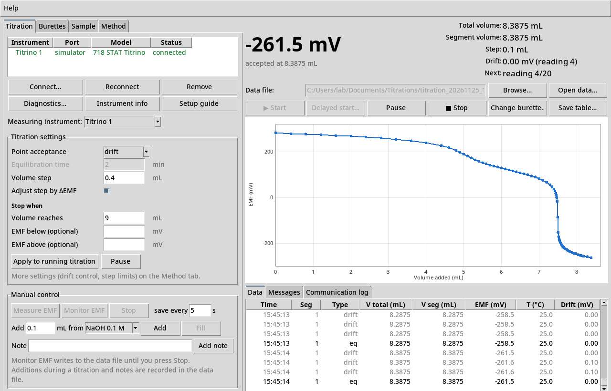
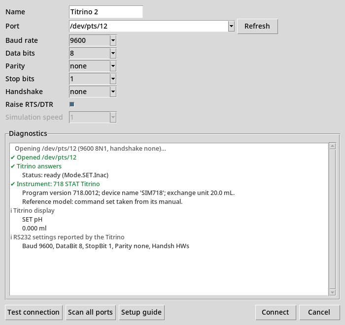

# CrossTitrate

Cross-platform titration software for **Metrohm Titrino** instruments controlled over
RS232. CrossTitrate runs potentiometric (EMF) titrations, plots them live, and saves the data.

*CrossTitrate is an independent project, not affiliated with or endorsed by Metrohm. Product names
are used only to describe compatibility.*
It also includes connection diagnostics and a built-in simulator.

It was written to replace an old Windows-only Visual Basic program used with a 718 STAT
Titrino.

- **Windows, macOS and Linux.** Installers bundle everything.
- **Titrations:**
  - Equilibrate for a fixed time per point, or until the EMF drift is below a limit.
  - Optionally halve or double the volume step depending on how much the EMF changed.
  - Stop at a volume, at an EMF limit, or by hand.
- **Burettes:**
  - Several burettes, on several Titrinos or on the D0/D1/D2 burettes of multi-burette models.
  - Dispense from one burette, or from several together in fixed ratios.
  - **Change burette during a titration.** The new concentrations are recorded, and a new
    volume segment starts.
  - Automatic refilling before a burette runs empty. Dispensed volumes are checked against
    the instrument's own volume counter.
- **Live plot and data table.**
  - Every reading is saved immediately, so a crash or power cut loses nothing.
  - Pause and resume, delayed start, manual measure/add/fill.
- **EMF monitor:** logs the EMF against time to a file at a set interval, with notes, e.g.
  to follow a sample while it freezes.
- **Diagnostics:**
  - Port and permission checks, handshake-line status.
  - Automatic baud and parity scan, instrument identification.
  - A live communication log, and plain-language advice for each problem.
- **Simulator.** Try everything without an instrument, at up to 300× speed.



*A titration of a strong + weak acid mixture with NaOH, using the built-in simulator.
Accepted points are blue; intermediate drift readings are grey.*



*Connection test: the program identifies the instrument and reads back its RS232 settings.
When something is wrong, it explains what to check.*

## Install

Download from the [Releases page](https://github.com/ohlincha/crosstitrate/releases) (newest at the top; v0.x releases are marked *Pre-release*):

| System | File | How |
|---|---|---|
| Windows | `CrossTitrate.exe` | Run it. If SmartScreen warns, choose *More info → Run anyway*. |
| macOS | `CrossTitrate-macOS-AppleSilicon.dmg` (M1/M2/…) or `CrossTitrate-macOS-Intel.dmg` | Drag *CrossTitrate* to Applications. The first time, right-click → *Open*. |
| Linux (Debian/Ubuntu) | `crosstitrate_<version>_all.deb` | `sudo apt install ./crosstitrate_*_all.deb`, then `sudo usermod -aG dialout $USER` and log out and in again. |

From source, on any OS, with Python ≥ 3.8 and Tk: `pip install pyserial`, then `python -m crosstitrate`.

## Connecting a Titrino

1. **Cable.** Connect the Titrino's RS232 socket (25-pin, marked *A* or *RS232*) to the
   computer. Use Metrohm cable 6.2125.060, plus adapter 6.2125.010 for 9-pin ports, or any
   null-modem cable. Most computers need a **USB–RS232 adapter**; FTDI-based adapters are
   the most reliable.
2. **Titrino settings.** Press `<configuration>` and go to `>RS232 settings`:

   | Setting | Value |
   |---|---|
   | baud rate | 9600 |
   | data bit | 8 |
   | stop bit | 1 |
   | parity | none |
   | handshake | none (or HWs with a fully wired cable) |
   | **RS control** | **ON**. With OFF, the Titrino ignores all commands. |

   Under `>peripheral units`, set *send to* to `IBM`. Leave the instrument idle, at its
   normal display. CrossTitrate selects MEAS mode and dispensing by itself.
3. **In CrossTitrate:** *Instruments → Connect…*, choose the port, and press **Test connection**.
   If it fails, the diagnostics say why and try other settings for you.

Network serial servers (e.g. Moxa NPort) also work: enter `socket://host:port` as the port.

## Running a titration

1. **Burettes tab:** define each burette: the instrument that drives it, the dispensing
   rate, and the concentrations of components H, B, C and D in mM (negative H
   for a base). Tick the burette(s) to use.
2. **Sample tab:** start volume V₀, temperature, start concentrations, comment.
3. **Titration tab** (the front tab): point acceptance, equilibration time, volume step,
   "Adjust step by ΔEMF" and the stop conditions (volume, EMF limits). The **Method tab**
   has the same settings, plus the drift-control parameters and the step limits.
   - *constant*: wait the equilibration time, then read.
   - *drift*: read every interval until |EMF − EMF N readings earlier| is below the limit,
     or the maximum number of readings is reached.
   - Methods can be saved and loaded as JSON.
4. Choose the data file and press **▶ Start**. The plot shows accepted points in blue and
   intermediate drift readings in grey.
5. **During the titration:**
   - **Change the step size or stop conditions:** edit them, then press **Apply to running
     titration**. The change takes effect at the next addition and is logged in the data
     file.
   - **Pause / Resume** freezes the waiting time. An addition that has already started
     finishes first.
   - **Manual additions** (*Add … mL from …*) are done at once and recorded in the data file.
     The equilibration then restarts at the new volume.
   - **Change burette…** switches burettes, or updates concentrations, at the next addition.
     The data file records the change, and the segment volume restarts at 0.
   - **Notes** typed in the *Note* field are written into the data file at that moment.
6. Outside a titration, **Measure EMF** and manual additions appear in the table and plot.
   Use **Save table…** to keep them.

## Monitoring the EMF over time

**Monitor EMF** (Manual control) follows the EMF without adding anything. The display updates
about once a second. A reading, with temperature, is written to the data file every *save every*
seconds, until you press **Stop**. The plot shows EMF against time. Notes (e.g. "ice forming")
are written into the file and marked on the plot. The file is named `monitor_….csv` unless
you choose another name, and **Open data…** shows it again later.

The temperature column holds whatever the Titrino reports. Without a temperature sensor
this is probably the temperature entered manually on the instrument, not a measurement.

## Data files

**CSV** (primary). A header of `# key: value` lines holds the sample, method, burettes,
instruments and start/end times as JSON. It's followed by one row per reading:

```
timestamp,elapsed_s,segment,kind,burettes,v_total_ml,v_segment_ml,emf_mv,temperature_c,drift_mv,note
```

`kind` is `eq` (accepted point), `drift` (intermediate reading), `manual`, `monitor` (EMF
monitor reading) or `event` (burette change, manual addition, settings change or note; details
in `note`). `v_total_ml` is cumulative over the whole titration; `v_segment_ml` restarts at
each burette change.

## Supported instruments

All Titrinos with RS232 remote control share one command language. CrossTitrate identifies the
model from its program version and adapts to it.

| Model | Notes |
|---|---|
| 718 STAT Titrino | Reference model (command set taken from its manual) |
| 702, 716, 719, 736, 794 | Standard Titrinos |
| **785 DMP** | **Tested with real hardware** (identify, EMF, dosing, filling, a full titration run) |
| 751 GPD, 798 MPT, 799 GPT | Also burettes D0/D1/D2 on one instrument |
| 720, 758, 784, 795 (KF) | No mV measurement; usable as burettes |

**Hardware status:** tested with a real 785 DMP Titrino over a USB–RS232 adapter on Linux.
Other models share the command language but are untested; please report results.

**Cable:** a straight serial cable does **not** work: no reply, no handshake lines, and E42 on
the Titrino. Use a null-modem cable or adapter (or Metrohm 6.2125.060), and set the Titrino's
handshake to "none" unless the cable carries all handshake lines.

**USB:** RS232 Titrinos work through any USB–RS232 adapter, on all three systems. The newer
USB-only instruments (Titrino plus 848/877, Titrando, OMNIS) use proprietary Metrohm
protocols that are not publicly documented. They are not supported.

## Troubleshooting

Start with *Instruments → Diagnostics…*. Common causes:

- **No answer:** RS control is OFF; wrong port; straight instead of null-modem cable;
  Titrino busy or showing a question.
- **E42 on the Titrino display:** a handshake problem. Set handshake to `none` on the
  Titrino, or keep *Raise RTS/DTR* ticked and use a fully wired cable.
- **Garbled data / E36–E37:** baud, parity or data bits differ. The diagnostics scan finds
  the right settings.
- **Linux "permission denied":** `sudo usermod -aG dialout $USER`, then log in again.
- **Windows, Prolific adapter "code 10":** use an FTDI-based adapter.

The *Communication log* tab shows every command and reply.

## Development

```sh
python -m venv .venv && .venv/bin/pip install pyserial
.venv/bin/python -m crosstitrate                  # GUI
.venv/bin/python -m unittest discover tests  # tests (use the simulator)
python -m crosstitrate.simserve                   # simulated Titrino on a virtual serial port
```

Code layout: `protocol.py` (Titrino command language), `transport.py` (serial/simulator
I/O and the traffic log), `instrument.py` (driver), `titration.py` (titration logic and
worker thread), `diagnostics.py`, `datafile.py`, `simulator.py`, `gui/`.

Pushing a tag `vX.Y.Z` builds the Windows, macOS and Linux installers on GitHub Actions
and publishes a release.

## License

MIT
