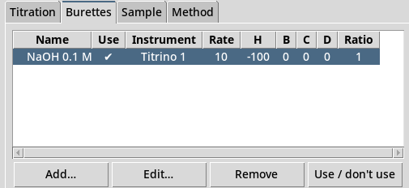
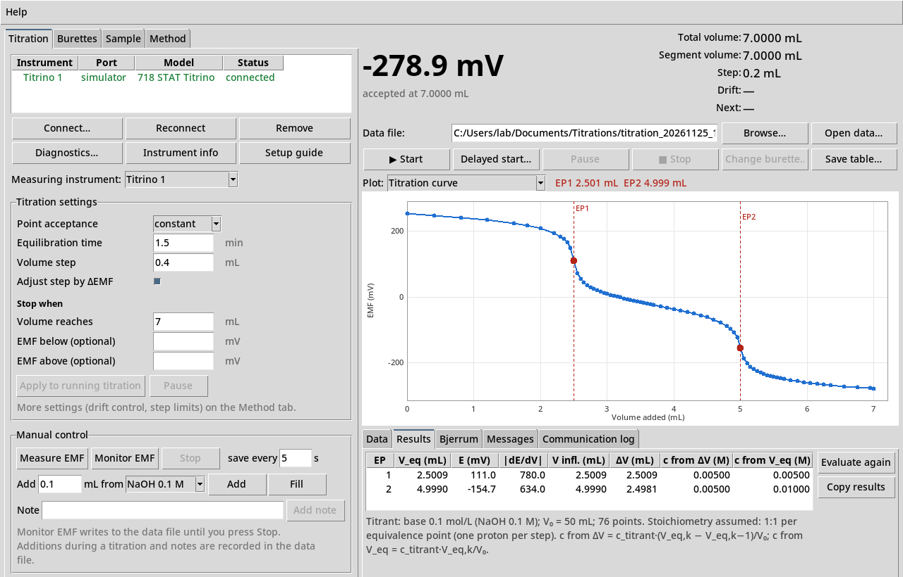
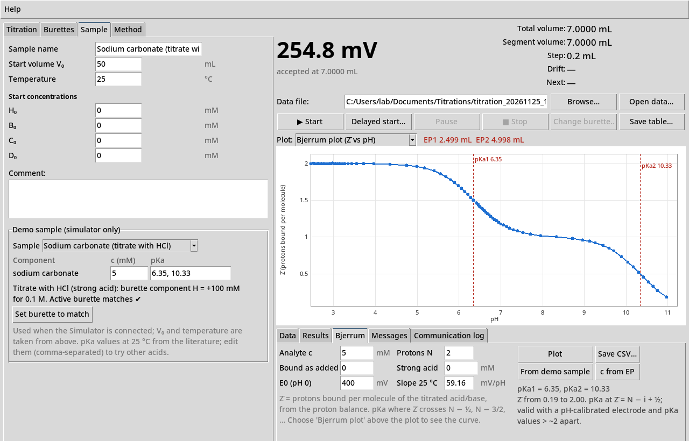

# CrossTitrate user manual

CrossTitrate runs potentiometric (EMF) titrations with a **Metrohm Titrino** connected over
RS232. It adds titrant step by step, waits for the EMF to settle, plots the curve live and
writes every reading to a CSV file. It also has connection diagnostics and a built-in
simulator, so you can learn the program without an instrument.

This manual covers the basics. More detail (data file format, supported models) is in the
README on <https://github.com/ohlincha/crosstitrate>. In the program, open this manual with
**Help → Manual** or **F1**.

*CrossTitrate is an independent project, not affiliated with or endorsed by Metrohm.*

## 1. Install

Download the file for your computer from the **Releases** page,
<https://github.com/ohlincha/crosstitrate/releases> (newest at the top):

| System | File | How |
|---|---|---|
| Windows | `CrossTitrate.exe` | Run it. If SmartScreen warns, choose *More info → Run anyway*. |
| macOS | `CrossTitrate-macOS-AppleSilicon.dmg` (M1, M2, …) or `CrossTitrate-macOS-Intel.dmg` | Drag *CrossTitrate* to Applications. The first time, right-click it and choose *Open*. |
| Debian / Ubuntu | `crosstitrate_<version>_all.deb` | `sudo apt install ./crosstitrate_<version>_all.deb`, then start *CrossTitrate* from the menu or type `crosstitrate`. |

**Linux serial-port permission.** The .deb gives the serial ports to whoever is logged in at
the computer, so no extra setup is needed: just unplug and replug the USB–RS232 adapter once
after installing (or reboot). If you use the computer over SSH, or run CrossTitrate without
the .deb, add yourself to the `dialout` group and log in again:

    sudo usermod -aG dialout $USER

**From source** (any system, Python 3.8 or newer with Tk): `pip install pyserial`, then
`python -m crosstitrate`.

## 2. Connect the Titrino

**Cable.** The Titrino's RS232 socket (25-pin, marked *A* or *RS232*) must be connected with a
**null-modem** cable: Metrohm cable 6.2125.060 (plus adapter 6.2125.010 for 9-pin ports), or any
null-modem cable. A straight serial cable does **not** work. Most computers need a
**USB–RS232 adapter**; FTDI-based adapters are the most reliable. The adapter appears as
`COM3` (or another number) on Windows, `/dev/ttyUSB0` on Linux and `/dev/cu.usbserial-…` on macOS.

**Settings on the Titrino.** Press `<configuration>` and go to `>RS232 settings`:

| Setting | Value |
|---|---|
| baud rate | 9600 |
| data bit | 8 |
| stop bit | 1 |
| parity | none |
| handshake | none (or HWs with a fully wired cable) |
| **RS control** | **ON**: with OFF the Titrino ignores every command |

Under `>peripheral units`, set *send to* to `IBM`. Connect the electrode to measuring input 1.
Leave the instrument idle at its normal display: CrossTitrate switches it to MEAS mode and
controls dispensing by itself.

**In CrossTitrate:**

1. On the **Titration** tab, press **Connect…**.
2. Give the instrument a name (e.g. *Titrino 1*) and choose the **Port**. Press **Refresh** if
   you plugged the adapter in after opening the window. Keep 9600 baud, 8 data bits, no
   parity, 1 stop bit, handshake *none*, and leave *Raise RTS/DTR* ticked.
3. Press **Test connection**. A working connection shows green ticks, the instrument model and
   the RS232 settings the Titrino reports (below). If the Titrino answers at other settings, the
   program offers to use them.
4. Press **Connect**. The instrument appears in the list with status *connected*.

{width=55%}

Not sure which port it is? **Scan all ports** tries each port and reports where a Titrino
answers. **Setup guide** shows the cable and Titrino settings again. Connected instruments are
remembered and reconnected the next time the program starts; **Reconnect** and **Remove**
act on the selected instrument.

**Supported instruments.** CrossTitrate has been tested with a real **785 DMP Titrino**. The
718 STAT Titrino is the reference model for its command set. Other RS232 Titrinos use the same
command language but have not been tested; **Instrument info** shows what the program knows
about the connected model. USB-only instruments (Titrando, OMNIS, …) are not supported.

**Trying it without an instrument.** Choose **Simulator (no hardware)** as the port. The
*Simulation speed* (up to 300×) makes a titration finish in minutes. Choose what is in the
simulated beaker under **Demo sample** on the Sample tab (section 3). The simulator is for
learning the program; its data are not real measurements, and data files made with it say so
(`# simulated_sample:` line).

## 3. Set up burettes and sample

**Burettes tab.** Each burette is a titrant on a connected instrument. Press **Add…** (or
select one and press **Edit…**) and enter:

- *Name* (e.g. *NaOH 0.1 M*) and the *Instrument* that drives it.
- *Burette on instrument*: only for multi-burette models; leave empty otherwise.
- *Dispensing rate* in mL/min.
- *Concentrations* of components H, B, C and D in mM. Use a negative H for a base
  (0.1 M NaOH: H = −100).
- *Volume ratio*: only when several burettes dispense together; each adds step × ratio.

Press **Use / don't use** to mark the burette(s) that dispense at every step (✔ in the *Use*
column).

{width=50%}

**Sample tab.** Sample name, start volume V₀ (mL), temperature (°C), start concentrations of H,
B, C, D (mM) and a free-text comment. All of it is saved in the data file. V₀ is also used to
calculate the sample concentration (section 6).

**Demo sample (simulator only).** At the bottom of the Sample tab, choose what the simulator
titrates. Each sample lists its components with an editable concentration (mM) and, for weak
acids and bases, their pKa values (literature values at 25 °C; comma-separated for polyprotic
acids; edit them to try another acid). The simulator calculates the pH from the charge balance
of everything in the beaker, so the curves have the right shape and equivalence points.

| Demo sample | Default | pKa (25 °C) | Titrate with | Equivalence points (V₀ 50 mL, 0.1 M titrant) |
|---|---|---|---|---|
| HCl | 10 mM | strong | NaOH | 5.00 mL |
| Acetic acid | 10 mM | 4.76 | NaOH | 5.00 mL |
| HCl + acetic acid | 5 + 5 mM | strong; 4.76 | NaOH | 2.50, 5.00 mL |
| Phosphoric acid | 5 mM | 2.15, 7.20, 12.35 | NaOH | 2.50, 5.00 mL (the third is not visible) |
| NaOH | 10 mM | strong | HCl | 5.00 mL |
| Sodium carbonate | 5 mM | 6.35, 10.33 | HCl | 2.50, 5.00 mL |
| Ammonia | 10 mM | 9.25 (NH₄⁺) | HCl | 5.00 mL |

The burette must hold the right titrant: NaOH for the acids, HCl for NaOH, carbonate and
ammonia. In CrossTitrate a base has a negative component H (0.1 M NaOH: H = −100 mM) and an acid
a positive one (0.1 M HCl: H = +100 mM). The Demo sample box says whether the active burette
matches; **Set burette to match** fixes it, and **▶ Start** offers to do the same. V₀ and the
temperature are taken from the Sample tab; the simulated electrode has E0 = 400 mV and a slope of
59.16 mV/pH.

## 4. Run a titration

1. **Choose the measuring instrument** (Titration tab, *Measuring instrument*): the Titrino
   whose electrode reads the EMF.
2. **Titration settings** (Titration tab):
   - *Point acceptance*: **constant** waits the *Equilibration time*, then reads the EMF;
     **drift** reads repeatedly until the EMF is stable (drift limit and number of readings on
     the **Method** tab).
   - *Volume step* in mL. With *Adjust step by ΔEMF* ticked, the step is halved when the EMF
     changes a lot and doubled when it changes little (limits on the Method tab).
   - *Stop when*: the total volume reaches a value, and optionally the EMF falls below or rises
     above a limit.
   - The **Method** tab has all settings and can **Save method…** / **Load method…** as a file.
3. **Data file**: a file name with date and time is suggested in your *Documents/Titrations*
   folder. Press **Browse…** to choose another.
4. Press **▶ Start**. **Delayed start…** starts at a date and time you enter (YYYY-MM-DD HH:MM).

During the titration the large number is the latest EMF; on the right are the total and
segment volume, the current step, the drift and what happens next. In the plot, accepted
points are blue and intermediate drift readings grey. The **Data** tab below lists every
reading.

- **Pause / Resume** freezes the waiting time (an addition that has started finishes first).
- **Change settings while running:** edit the step size or stop conditions, then press
  **Apply to running titration**. The change takes effect at the next addition and is noted in
  the data file.
- **Manual addition:** *Add [volume] mL from [burette]* → **Add**. It is done at once, recorded,
  and the equilibration restarts.
- **Change burette…** switches to other burette(s) or new concentrations at the next addition.
  A new segment starts (the segment volume restarts at 0).
- **Note:** type a remark and press **Add note** (or Enter); it is written into the data file.
- **■ Stop** ends the titration (after you confirm). Otherwise it ends by itself at a stop condition, and a
  message shows where the data were saved.

Every reading is written to the file immediately, so a crash or power cut loses nothing.

## 5. Manual control and EMF monitoring

Outside a titration, the **Manual control** box works on the connected instrument:

- **Measure EMF** takes one reading. **Add** dispenses a volume; **Fill** refills a burette.
  These readings appear in the table and plot; keep them with **Save table…**.
- **Monitor EMF** records the EMF against time (e.g. while a sample freezes). The display updates
  about once a second, and a reading is written to the data file every *save every* seconds until
  you press **Stop**. Notes are written to the file and marked on the plot. The file is named
  `monitor_….csv` unless you choose another name.

## 6. Evaluating and reporting results

**Equivalence points.** During and after a titration, CrossTitrate evaluates the accepted points
(blue) and lists the equivalence points on the **Results** tab below the plot; they are marked
EP1, EP2, … in red in the plot. **Open data…** shows the results of a saved file again.

- **V_eq** is where |dE/dV| has its maximum: the slope between neighbouring points is calculated,
  and the peak is refined by a parabola through the steepest interval and its neighbours, so V_eq
  falls between measured points. Small, noisy bumps are ignored (a peak must reach 5 % of the
  highest one and stand out clearly from its surroundings).
- **E** is the EMF at V_eq (interpolated); **|dE/dV|** the slope there (mV/mL).
- **V infl.** is a cross-check: the inflection point (second derivative = 0) of a cubic through
  the two points on each side of the jump. It agrees with V_eq for a clean, symmetric jump; if
  they differ by more than a step, look at the curve.
- **Concentration**, assuming **1:1 stoichiometry per equivalence point** (one proton per step):
  - *c from ΔV* = c_titrant × (V_eq,k − V_eq,k−1) / V₀: what was titrated between the previous
    and this equivalence point. Phosphoric acid gives the H₃PO₄ concentration at EP1 and again at
    EP2; HCl + acetic acid gives HCl at EP1 and acetic acid at EP2.
  - *c from V_eq* = c_titrant × V_eq,k / V₀: everything titrated up to this point (e.g. total
    alkalinity at the second carbonate equivalence point = 2 × [Na₂CO₃]).
  - c_titrant comes from component H of the active burette (as entered on the Burettes tab), V₀
    from the Sample tab. Enter the standardised titrant concentration there. If the burette was
    changed during the titration, the concentration uses the first burette (a note says so).

For best results use small steps near the equivalence point (*Adjust step by ΔEMF*). On simulated
curves the equivalence volumes come out within 0.1 % (0.1 mL steps), except the first point of
HCl + acetic acid (1–2 % high or low, because acetic acid already reacts before all HCl is used
up, so that jump is small).

**What to report.** The sample (name, volume V₀, preparation), the titrant and its concentration
and how it was standardised (against what, when), the electrode, V_eq for each equivalence
point, the concentration and the stoichiometry assumed, the number of repeated titrations and
the mean ± standard deviation of the concentration (e.g. 0.01003 ± 0.00004 mol/L, n = 3).
For the mean and SD, paste the `_results.csv` files of the repeats below each other in a
spreadsheet (they have no extra header lines for that reason).

**Files.** At the end of a titration the results are written:

- into the data file, as one line `# results: {…}` (JSON) before the `# end:` line, and
- into `<data file>_results.csv`, one row per equivalence point, with the columns
  `data_file, sample, ep, v_eq_ml, e_eq_mv, dedv_max_mv_per_ml, v_inflection_ml, dv_ml, titrant,
  c_titrant_mol_l, v0_ml, c_step_mol_l, c_cum_mol_l, stoichiometry`
  (`c_step_mol_l` = c from ΔV, `c_cum_mol_l` = c from V_eq).

**Evaluate again** recalculates from the points shown; **Copy results** copies the table for a
spreadsheet.

### Bjerrum plot and pKa

For an acid–base titration CrossTitrate can draw Bjerrum's **formation function**: Z̄, the average
number of protons bound per molecule of the titrated acid or base, against pH. Choose
**Bjerrum plot (Z̄ vs pH)** above the plot, and enter the data on the **Bjerrum** tab.

Z̄ follows from a proton balance at every point: the protons put in (bound to the analyte as
added, strong acid in the sample, acid titrant) minus the strong base (in the sample and the
titrant) are either bound to the analyte or free:

  Z̄ = (C·n₀ + C_acid − C_base − [H⁺] + [OH⁻]) / C,

with every concentration diluted to V₀ + V, [H⁺] = 10^−pH^ and [OH⁻] = 10⁻¹⁴/[H⁺].

**pKa from Z̄.** For an acid with N dissociable protons, Z̄ falls from N to 0. pKa₁ is the pH
where Z̄ = N − ½, pKa₂ where Z̄ = N − 3/2, and so on (for acetic acid pKa at Z̄ = 0.5; for
phosphoric acid pKa₁ at 2.5, pKa₂ at 1.5, pKa₃ at 0.5). CrossTitrate interpolates these crossings,
marks them in the plot and lists them on the Bjerrum tab. This reading is exact when the pKa
values are more than about 2 units apart; closer pKa values overlap and need a fit.

**What it needs.**

- A **pH-calibrated electrode**: Z̄ is calculated from the pH, pH = (E0 − E) / slope, with the
  slope scaled to the sample temperature. Enter E0 (the EMF at pH 0) and the slope at 25 °C from
  a calibration with buffers. A 3 mV error in E0 shifts every pKa by 0.05.
- The analyte's **total concentration** C (mM, in the sample before titration), from the sample
  preparation, or **c from EP** (c from ΔV of the last equivalence point). A 2 % error in C
  shifts the pKa of a monoprotic acid by about 0.02 and the middle pKa of phosphoric acid by 0.05.
- **Protons N** of the fully protonated form (H₃PO₄ 3, H₂CO₃ 2, acetic acid 1, NH₄⁺ 1),
  **Bound as added** (protons on the form you weighed in: H₃PO₄ 3, acetic acid 1, Na₂CO₃ 0, NH₃ 0)
  and any **Strong acid** in the sample (e.g. the HCl in HCl + acetic acid; negative for NaOH).
- The titrant concentration (from the burette) and V₀ (from the Sample tab).

**From demo sample** fills everything in for the simulator (it is done automatically when a
titration on the simulator starts). On the demo samples the pKa values come out within 0.01 of
the true values: acetic acid 4.76, phosphoric acid 7.20 (and 2.15 when the concentration is
raised to 50 mM), carbonate 6.35 and 10.33, ammonia 9.25.

**Limits.** Near the ends of the pH range Z̄ is the small difference of large numbers: below pH
about 2.5 (free H⁺) and above about 11.5 (free OH⁻) it becomes unreliable, and a half-integer
there may never be reached. Phosphoric acid at 5 mM never reaches Z̄ = 2.5 (pKa₁ 2.15), and
pKa₃ = 12.35 lies beyond the titration; such pKa values are shown as "not reached". A strong acid
in the sample must be entered correctly, or Z̄ is shifted by C_acid/C over the whole curve.

The Z̄ data are saved as `<data file>_bjerrum.csv` (columns `v_total_ml, emf_mv, ph, zbar`, with
the parameters and pKa estimates in `#` lines at the top) at the end of a titration when the
Bjerrum tab is filled in, or with **Save CSV…** on the Bjerrum tab.

## 7. Data files

- Data are saved as **CSV** files that open in Excel, LibreOffice, Origin, Python and so on.
  Lines starting with `#` at the top hold the sample, method, burettes and instruments; then
  there is one row per reading with time, volumes, EMF, temperature, drift and notes.
- The `kind` column says what a row is: `eq` (accepted point), `drift` (intermediate reading),
  `manual`, `monitor`, or `event` (burette change, manual addition, settings change or note).
- **Open data…** shows a saved titration or monitor file again in the plot and table.
- **Save table…** saves the rows currently in the table (useful for manual measurements).
- Next to the data file, `…_results.csv` holds the equivalence points and concentrations and
  `…_bjerrum.csv` the Bjerrum data (section 6).
- The **Messages** tab lists what happened; the **Communication log** tab shows every command
  sent to the Titrino and every reply.

The temperature column holds whatever the Titrino reports; without a temperature sensor that
is probably the value entered on the instrument, not a measurement.

## 8. Troubleshooting

Start with **Diagnostics…** on the Titration tab (or **Test connection** in the Connect
dialog). It checks the port and permissions, tries other baud rates and parities, identifies the
instrument, and explains each problem in plain words.

| Problem | What to check |
|---|---|
| Status *no answer* | RS control is OFF on the Titrino; wrong port; straight cable instead of null-modem; the Titrino is busy or shows a question. Press **Diagnostics…**. |
| Wrong port / don't know the port | Unplug the adapter, press **Refresh**, plug it in, press **Refresh** again: the new entry is the adapter. Or use **Scan all ports**. A *Bluetooth* port is never the Titrino. |
| No serial ports found | Plug in the adapter. If it still does not appear, install its driver (FTDI or Prolific). |
| Linux: "permission denied" | Installed from the .deb: unplug and replug the adapter (or reboot). Over SSH or without the .deb: `sudo usermod -aG dialout $USER`, then log in again. |
| Connects only if the Titrino is switched on *after* CrossTitrate opened the port | Fixed in 0.4.3: CrossTitrate wakes a Titrino that was already on (XON + empty line, up to three tries). If it still happens, press **Test connection** with the Titrino on and send the diagnostics text to the developer. |
| **E42** on the Titrino display | Handshake problem. Set handshake to *none* on the Titrino, or keep *Raise RTS/DTR* ticked and use a fully wired cable. |
| Garbled replies / E36–E37 | Baud, parity or data bits differ between Titrino and program. The diagnostics scan finds the right settings. |
| Windows, Prolific adapter "code 10" | Use an FTDI-based adapter. |
| "Connect the measuring instrument first" | Connect a Titrino and select it as *Measuring instrument*. |

If you report a problem, include the text of the Diagnostics window and the Communication
log.
