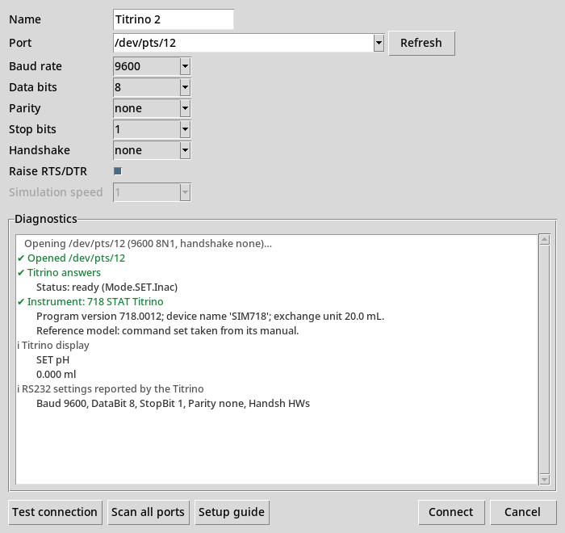

# CrossTitrate user manual

CrossTitrate runs potentiometric (EMF) titrations with a **Metrohm Titrino** connected over
RS232. It adds titrant step by step, waits for the EMF to settle, plots the curve live and
writes every reading to a CSV file. It also has connection diagnostics and a built-in
simulator, so you can learn the program without an instrument.

This manual covers the basics. More detail (data file format, supported models) is in the
README on <https://github.com/ohlincha/crosstitrate>. In the program, open this manual with
**Help → Manual** or **F1**.

*CrossTitrate is an independent project, not affiliated with or endorsed by Metrohm.*

## 1. Install

Download the file for your computer from the **Releases** page,
<https://github.com/ohlincha/crosstitrate/releases> (newest at the top):

| System | File | How |
|---|---|---|
| Windows | `CrossTitrate.exe` | Run it. If SmartScreen warns, choose *More info → Run anyway*. |
| macOS | `CrossTitrate-macOS-AppleSilicon.dmg` (M1, M2, …) or `CrossTitrate-macOS-Intel.dmg` | Drag *CrossTitrate* to Applications. The first time, right-click it and choose *Open*. |
| Debian / Ubuntu | `crosstitrate_<version>_all.deb` | `sudo apt install ./crosstitrate_<version>_all.deb`, then start *CrossTitrate* from the menu or type `crosstitrate`. |

**Linux serial-port permission.** The .deb gives the serial ports to whoever is logged in at
the computer, so no extra setup is needed: just unplug and replug the USB–RS232 adapter once
after installing (or reboot). If you use the computer over SSH, or run CrossTitrate without
the .deb, add yourself to the `dialout` group and log in again:

    sudo usermod -aG dialout $USER

**From source** (any system, Python 3.8 or newer with Tk): `pip install pyserial`, then
`python -m crosstitrate`.

## 2. Connect the Titrino

**Cable.** The Titrino's RS232 socket (25-pin, marked *A* or *RS232*) must be connected with a
**null-modem** cable: Metrohm cable 6.2125.060 (plus adapter 6.2125.010 for 9-pin ports), or any
null-modem cable. A straight serial cable does **not** work. Most computers need a
**USB–RS232 adapter**; FTDI-based adapters are the most reliable. The adapter appears as
`COM3` (or another number) on Windows, `/dev/ttyUSB0` on Linux and `/dev/cu.usbserial-…` on macOS.

**Settings on the Titrino.** Press `<configuration>` and go to `>RS232 settings`:

| Setting | Value |
|---|---|
| baud rate | 9600 |
| data bit | 8 |
| stop bit | 1 |
| parity | none |
| handshake | none (or HWs with a fully wired cable) |
| **RS control** | **ON**: with OFF the Titrino ignores every command |

Under `>peripheral units`, set *send to* to `IBM`. Connect the electrode to measuring input 1.
Leave the instrument idle at its normal display: CrossTitrate switches it to MEAS mode and
controls dispensing by itself.

**In CrossTitrate:**

1. On the **Titration** tab, press **Connect…**.
2. Give the instrument a name (e.g. *Titrino 1*) and choose the **Port**. Press **Refresh** if
   you plugged the adapter in after opening the window. Keep 9600 baud, 8 data bits, no
   parity, 1 stop bit, handshake *none*, and leave *Raise RTS/DTR* ticked.
3. Press **Test connection**. A working connection shows green ticks, the instrument model and
   the RS232 settings the Titrino reports (below). If the Titrino answers at other settings, the
   program offers to use them.
4. Press **Connect**. The instrument appears in the list with status *connected*.

{width=55%}

Not sure which port it is? **Scan all ports** tries each port and reports where a Titrino
answers. **Setup guide** shows the cable and Titrino settings again. Connected instruments are
remembered and reconnected the next time the program starts; **Reconnect** and **Remove**
act on the selected instrument.

**Supported instruments.** CrossTitrate has been tested with a real **785 DMP Titrino**. The
718 STAT Titrino is the reference model for its command set. Other RS232 Titrinos use the same
command language but have not been tested; **Instrument info** shows what the program knows
about the connected model. USB-only instruments (Titrando, OMNIS, …) are not supported.

**Trying it without an instrument.** Choose **Simulator (no hardware)** as the port. The
*Simulation speed* (up to 300×) makes a titration finish in minutes. The simulator is for
learning the program; its data are not real measurements.

## 3. Set up burettes and sample

**Burettes tab.** Each burette is a titrant on a connected instrument. Press **Add…** (or
select one and press **Edit…**) and enter:

- *Name* (e.g. *NaOH 0.1 M*) and the *Instrument* that drives it.
- *Burette on instrument*: only for multi-burette models; leave empty otherwise.
- *Dispensing rate* in mL/min.
- *Concentrations* of components H, B, C and D in mM. Use a negative H for a base
  (0.1 M NaOH: H = −100).
- *Volume ratio*: only when several burettes dispense together; each adds step × ratio.

Press **Use / don't use** to mark the burette(s) that dispense at every step (✔ in the *Use*
column).

{width=50%}

**Sample tab.** Sample name, start volume V₀ (mL), temperature (°C), start concentrations of H,
B, C, D (mM) and a free-text comment. All of it is saved in the data file.

## 4. Run a titration

1. **Choose the measuring instrument** (Titration tab, *Measuring instrument*): the Titrino
   whose electrode reads the EMF.
2. **Titration settings** (Titration tab):
   - *Point acceptance*: **constant** waits the *Equilibration time*, then reads the EMF;
     **drift** reads repeatedly until the EMF is stable (drift limit and number of readings on
     the **Method** tab).
   - *Volume step* in mL. With *Adjust step by ΔEMF* ticked, the step is halved when the EMF
     changes a lot and doubled when it changes little (limits on the Method tab).
   - *Stop when*: the total volume reaches a value, and optionally the EMF falls below or rises
     above a limit.
   - The **Method** tab has all settings and can **Save method…** / **Load method…** as a file.
3. **Data file**: a file name with date and time is suggested in your *Documents/Titrations*
   folder. Press **Browse…** to choose another.
4. Press **▶ Start**. **Delayed start…** starts at a date and time you enter (YYYY-MM-DD HH:MM).

During the titration the large number is the latest EMF; on the right are the total and
segment volume, the current step, the drift and what happens next. In the plot, accepted
points are blue and intermediate drift readings grey. The **Data** tab below lists every
reading.

- **Pause / Resume** freezes the waiting time (an addition that has started finishes first).
- **Change settings while running:** edit the step size or stop conditions, then press
  **Apply to running titration**. The change takes effect at the next addition and is noted in
  the data file.
- **Manual addition:** *Add [volume] mL from [burette]* → **Add**. It is done at once, recorded,
  and the equilibration restarts.
- **Change burette…** switches to other burette(s) or new concentrations at the next addition.
  A new segment starts (the segment volume restarts at 0).
- **Note:** type a remark and press **Add note** (or Enter); it is written into the data file.
- **■ Stop** ends the titration (after you confirm). Otherwise it ends by itself at a stop condition, and a
  message shows where the data were saved.

Every reading is written to the file immediately, so a crash or power cut loses nothing.

## 5. Manual control and EMF monitoring

Outside a titration, the **Manual control** box works on the connected instrument:

- **Measure EMF** takes one reading. **Add** dispenses a volume; **Fill** refills a burette.
  These readings appear in the table and plot; keep them with **Save table…**.
- **Monitor EMF** records the EMF against time (e.g. while a sample freezes). The display updates
  about once a second, and a reading is written to the data file every *save every* seconds until
  you press **Stop**. Notes are written to the file and marked on the plot. The file is named
  `monitor_….csv` unless you choose another name.

## 6. Results and data files

- Data are saved as **CSV** files that open in Excel, LibreOffice, Origin, Python and so on.
  Lines starting with `#` at the top hold the sample, method, burettes and instruments; then
  there is one row per reading with time, volumes, EMF, temperature, drift and notes.
- The `kind` column says what a row is: `eq` (accepted point), `drift` (intermediate reading),
  `manual`, `monitor`, or `event` (burette change, manual addition, settings change or note).
- **Open data…** shows a saved titration or monitor file again in the plot and table.
- **Save table…** saves the rows currently in the table (useful for manual measurements).
- The **Messages** tab lists what happened; the **Communication log** tab shows every command
  sent to the Titrino and every reply.

The temperature column holds whatever the Titrino reports; without a temperature sensor that
is probably the value entered on the instrument, not a measurement.

## 7. Troubleshooting

Start with **Diagnostics…** on the Titration tab (or **Test connection** in the Connect
dialog). It checks the port and permissions, tries other baud rates and parities, identifies the
instrument, and explains each problem in plain words.

| Problem | What to check |
|---|---|
| Status *no answer* | RS control is OFF on the Titrino; wrong port; straight cable instead of null-modem; the Titrino is busy or shows a question. Press **Diagnostics…**. |
| Wrong port / don't know the port | Unplug the adapter, press **Refresh**, plug it in, press **Refresh** again: the new entry is the adapter. Or use **Scan all ports**. A *Bluetooth* port is never the Titrino. |
| No serial ports found | Plug in the adapter. If it still does not appear, install its driver (FTDI or Prolific). |
| Linux: "permission denied" | Installed from the .deb: unplug and replug the adapter (or reboot). Over SSH or without the .deb: `sudo usermod -aG dialout $USER`, then log in again. |
| **E42** on the Titrino display | Handshake problem. Set handshake to *none* on the Titrino, or keep *Raise RTS/DTR* ticked and use a fully wired cable. |
| Garbled replies / E36–E37 | Baud, parity or data bits differ between Titrino and program. The diagnostics scan finds the right settings. |
| Windows, Prolific adapter "code 10" | Use an FTDI-based adapter. |
| "Connect the measuring instrument first" | Connect a Titrino and select it as *Measuring instrument*. |

If you report a problem, include the text of the Diagnostics window and the Communication
log.
